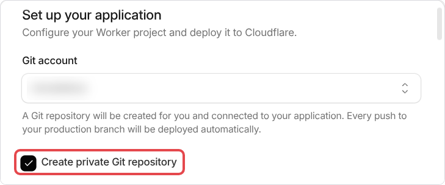
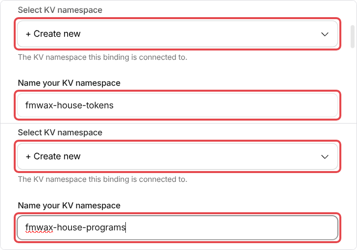
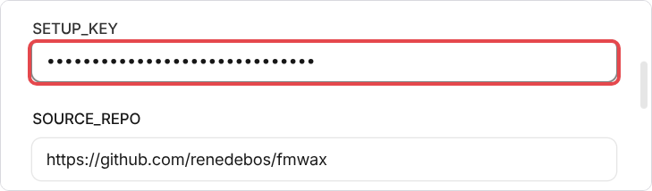
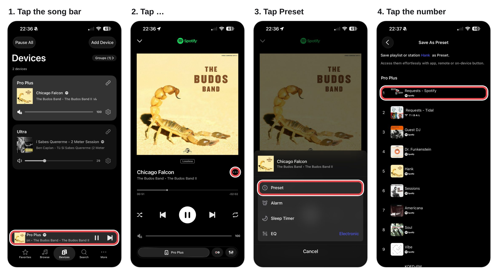

# Start here

This guide sets up **fmwax**: radio-style DJs for your WiiM speaker's preset buttons, curated by Claude or ChatGPT.

You ask a DJ for music on your phone, typed or spoken, in the Claude app or in ChatGPT. For example: *"Vibe, play me 20 minutes for a quiet morning."* A few minutes later the set is playing on your WiiM. It also stays on a preset button, so a press on the WiiM's remote plays your latest set again.

Claude and ChatGPT work the same way here. Use the one you already have.

## What you get, level by level

You install Level 1 first, in about an hour. Everything after it is added later from your house's setup page, when you want it. **You can stop at any level and it works.**

| Level | What you get | What it needs | Time |
|---|---|---|---|
| **Level 1 · Ask a DJ** | Ask any of the eleven DJs for a set, in Claude or ChatGPT. It plays on your WiiM and stays on one preset button, Requests. Your house's own app on your phone. | Spotify Premium. Free Cloudflare and GitHub accounts. Claude or ChatGPT (a free ChatGPT account worked in our test). | about an hour |
| **Level 2 · DJ presets** | A DJ on a preset button of their own, with an hour of their songs on it from the start. For new songs, ask that DJ for a set. | Nothing more. | a few minutes per added preset |
| **Level 3 · Endless** | Your DJ presets add songs by themselves for as long as you listen. A guest DJ preset for any DJ. Ask from the DJ pages in your house's app. | A paid plan: Claude Pro or ChatGPT Plus (or higher). | 30 to 45 minutes |
| **Extra · Home helper** | A small program on a computer at home. While it runs, your house sees what is saved on each WiiM preset, and can press them for you. | A computer at home (Mac, Windows or Linux). It helps whenever that computer is on; it need not stay on. | 15 minutes |
| **Extra · Talk** | Ask by voice in your house's app: a DJ, a preset, "more like this". | Your own OpenAI API key, paid by the minute (about 5 cents). Not part of ChatGPT Plus. | 10 to 15 minutes |

The extras can be added at any level.

**This guide is Level 1.** Levels 2 and 3 are steps on your house's setup page, for when you want them: [DJ presets](docs/install/dj-presets.md) and [Endless DJs](docs/install/endless.md).

## What it costs

| | |
|---|---|
| **Spotify Premium** | Paid. Spotify only lets an app start music on a speaker for a paying account. |
| **Claude or ChatGPT** | Levels 1 and 2 are best with a paid plan: Claude Pro (or higher), or ChatGPT Plus (or higher). ChatGPT's free plan worked in one test of this guide (November 2026): it made a set and played it, with a lower daily message limit. Claude's free plan has not been tried. **Level 3 (Endless) needs a paid plan.** |
| **Cloudflare** | Free, no card. Your fmwax runs on your own Cloudflare account. |
| **GitHub** | Free. Your own copy of fmwax is kept there. |

Nothing else is paid. Nothing is shared with the author: everything runs on your own accounts.

## What you need

- **A WiiM speaker** (Mini, Pro, Pro Plus, Ultra, Amp…), already set up in the WiiM Home app, on the same Wi-Fi as your phone.
- **A computer with a web browser**, a laptop or a desktop. Some steps only work in a browser on a computer.
- **Under an hour.** The two sign-ups and the Spotify step take the longest.

## Before you start: two free accounts

**1. A Cloudflare account.** Sign up at [cloudflare.com](https://www.cloudflare.com). You don't need a card.

- Click the link in Cloudflare's "verify your email" message.
- Then open [Cloudflare's Workers page](https://dash.cloudflare.com/?to=/:account/workers-and-pages) once. This gives your account its own web address. If it asks you to choose a name for that address (a *subdomain*), accept the one it suggests. If it offers to create an application, skip that.

**2. A GitHub account.** Sign up at [github.com/signup](https://github.com/signup).

- **If you already have a GitHub account that is connected to another Cloudflare account**, make a new GitHub account for fmwax. One GitHub account can only be connected to one Cloudflare account.
- If GitHub's sign-up page says **Too many requests**, that's GitHub's own limit, not something you did. Wait 15 minutes, or sign up on your phone with its Wi-Fi turned off.

**No GitHub account, and you'd rather not make one?** There is another way to install, from your computer's terminal: [Install from a terminal](docs/install/terminal.md). The result is the same.

## How it fits together

```text
   ASKING (your phone)                      PLAYING (the room)

   "Vibe, 20 minutes…"                      press preset 1
          │                                        │
          ▼                                        ▼
   ┌─────────────┐                          ┌─────────────┐
   │ Claude app  │                          │ WiiM speaker│
   │ or ChatGPT  │                          └──────▲──────┘
   └──────┬──────┘                                 │ the music
          ▼                                        │
   ┌──────────────────────┐   writes   ╔═══════════╧══════════╗
   │ your fmwax, on your  │ ─────────▶ ║ a playlist in your    ║
   │ Cloudflare account   │            ║ Spotify account        ║
   └──────────────────────┘            ╚═══════════════════════╝
```

- **The music comes from Spotify, straight to the WiiM.** If fmwax were ever down, every preset would still play what was last put on it.
- **A preset remembers a playlist, not the songs in it.** You save each preset once. After that, fmwax only changes the songs in the playlist.
- **Nothing runs at home.** You need a computer to set things up, not to play music.

In this guide, your own fmwax is called **your house**. It has a web address of its own, with pages you can open on your phone.

## Step 1. Open the start page

**[Open the start page](https://renedebos.github.io/fmwax/)** and keep it open.

It makes your house's *setup key*: a password that proves the house is yours. The key is made in your own browser and sent nowhere. The page also has the Deploy button for Step 2, and at the end it opens your house's setup page with the key already filled in.

Copy the key into a note of your own too, in case the page is closed before you are done.

*Would you rather make your own?* Any password of **24 characters or more** works. Write it in a note first, and always paste it, never type it: Cloudflare's form hides what you type, so a wrong character goes unnoticed and locks you out.

## Step 2. Press the Deploy button

If you are signed in to other Cloudflare or GitHub accounts in this browser, open the start page in a private (incognito) window, so fmwax can't land on the wrong account.

Press **Deploy to Cloudflare** on the start page, or this button:

[](https://deploy.workers.cloudflare.com/?url=https://github.com/renedebos/fmwax)

1. **Sign in to Cloudflare.** If it asks which account, pick the one for fmwax. A form called *Set up your application* opens.
2. **Connect GitHub.** Click the **Git account** box to open its list.
   - **Your GitHub name is in the list:** choose it, and skip to step 4.
   - **It is not:** choose **New GitHub connection**. GitHub opens. Sign in, choose **All repositories**, then click **Install & Authorize**. (You can narrow this later to your fmwax copy only, in GitHub's Settings, Applications.)
   - **GitHub shows a settings page with a grey Save button instead of Install:** Cloudflare is already connected to this GitHub account. Change nothing there, and go on to step 3. If your GitHub name is still missing from the list after step 3, the account is connected to *another* Cloudflare account: make a new GitHub account (see *Before you start*).
3. **Cloudflare may now show a page called "Select a repository".** This is a detour. **Don't pick anything on this page**, not even *Clone a public repository*. Instead, press the Deploy button again (on the start page, or paste this into the address bar: `https://deploy.workers.cloudflare.com/?url=https://github.com/renedebos/fmwax`). The fmwax form opens again: click the **Git account** box and choose your GitHub name. The rest of the form then appears.
4. **Change four things on the form, and leave everything else as it is.** The form scrolls inside its own box: scroll down within it to see every part.

   | On the form | What to do |
   |---|---|
   | **Create private Git repository** | Check this box. Your copy doesn't need to be public. |
   | The two **Select KV namespace** boxes | In each, choose **+ Create new**, even if it already shows a name. Then, in the **Name your KV namespace** box that appears below, type **`fmwax-house-tokens`** in the first and **`fmwax-house-programs`** in the second. |
   | **SETUP_KEY** | Paste your setup key (the start page's **Copy the key**). |
   | **Enable Preview builds** | Near the bottom of the form. Switch it **off** if it is on. |

   What the first three look like when they're done:

   

   

   

   Why the two boxes: they are the two stores your house keeps its data in. Cloudflare suggests the same name for both, and two stores can't share a name, so the deploy would fail. If your Cloudflare account already has stores, Cloudflare may fill in their names: never keep those, because they belong to something else and the data would mix.

   Leave the rest alone: the project name (`fmwax-house`, which becomes the start of your house's address), **SOURCE_REPO** and the filled-in boxes after it, the two commands, **Protect with Cloudflare Access** (off: it would block Claude and ChatGPT), and **Advanced settings** (closed).

   Then click **Deploy**, at the bottom right.
5. **Wait about a minute.** The steps turn green one by one. The log underneath ends with **Success! Build completed**. A few lines above that is your house's address, as plain text. It looks like `https://fmwax-house.your-name.workers.dev`. (Cloudflare's own pages may say "No URLs enabled": the address works all the same.)
6. **Click Copy build log** (top right of the log), **paste it into the start page's last box**, and click **Open my setup page**. The start page finds the address in the log, and your house's setup page opens with the key already filled in. (Without the start page: copy the address from the log into your browser's address bar. It goes to the setup page.)

If the build fails, see [If something goes wrong](docs/install/troubleshooting.md).

## Step 3. Claim your house

Your house's setup page opens and asks for the setup key.

1. Click **Claim this house**. The key is already filled in if you came from the start page; if not, paste it. From now on, only a browser you have signed in can change your house's settings.
2. You are shown a **recovery code**, once. Click **Save it in my passwords**: your browser offers to keep it, like any password. Or click **Copy the code** and paste it into your note. You need it to sign in on your phone or another browser.

This browser stays signed in for a year.

## Step 4. Follow the setup page

The setup page is a checklist. Each step ticks itself when your house sees it done. You can stop and come back later.

A step marked **?** is one your house can't check for itself, like a preset saved on the WiiM. Check it yourself, by pressing the preset. (The optional [home helper](docs/install/home-helper.md) lets your house see these too.)

Do the steps under **Level 1 · Ask a DJ** in order:

1. **Spotify.** Your house needs its own free "app" entry in Spotify's developer website, so it can use your Spotify account. The page tells you exactly what to click and what to paste. At the end, you sign in to Spotify.
2. **Speakers.** Your house finds your speakers through Spotify. Check which ones are WiiM speakers, then pick the one music plays on by default. If a WiiM shows up as a code instead of its name, click **Play on it** to hear which one it is, then name it. If no speaker shows up at all, play any song on your WiiM from the Spotify app (choose the WiiM as the speaker there), then click **find again** on the page.
3. **Time zone.** Already set, from your browser, when you claimed your house. Change it here if it's wrong.
4. **Claude or ChatGPT.** This step adds your house to Claude or ChatGPT, so you can ask the DJs. Do it in a web browser, at [claude.ai](https://claude.ai) or [chatgpt.com](https://chatgpt.com): a computer's or your phone's browser both work, but the phone *apps* can't add it. The page shows each click. In ChatGPT, set **Authentication** to **None**: your house's address already carries its key. Afterwards it works in the Claude or ChatGPT app on your phone too.
5. **On your phone.** Your house has an app of its own. It is a web app: you add it to your home screen, with no app store.
   1. On your phone, open your house's setup address (the setup page has a button to copy it), and sign in with the recovery code.
   2. Tap **Open the house**.
   3. Add it to your home screen. **iPhone:** in Safari, tap Share (the square with the arrow), then **Add to Home Screen**. **Android:** in Chrome, tap ⋮, then **Add to Home screen** or **Install app**.

   It then opens like any app: what's playing, your speakers and presets, and the DJs. Anyone at home can have it too: open the house in your phone's browser and share that address with them. Whoever has it can use your house, so keep it in the household ([Links are keys](docs/install/privacy.md#links-are-keys)).
6. **Requests preset.** Choose a preset number for your requests (1 is suggested). Your house makes a playlist for it, with a few songs in it to start with, so you can save it on the preset of each WiiM right away (see Step 5). Then ask a DJ for a set (see *Your first set*, below): it takes the place of those songs.

## Step 5. Save a preset on your WiiM

There is one way that works:

1. In the **Spotify app**, open the playlist and play it **on the WiiM**. The device picker should show the WiiM's name, not your phone.
2. In the **WiiM Home app**, choose that WiiM, tap the song bar at the bottom, then **…**, then **Preset**, then the number.



Start the playlist from the Spotify app, not from Claude, ChatGPT or your house's pages. Started another way, the WiiM Home song bar can stay blank, and a blank song bar can't be saved.

Do this once on each WiiM. You never need to save that preset again: from then on, your house changes what is in the playlist.

## Your first set

Ask in the Claude app or ChatGPT, typed or spoken. Two good first asks:

- **Quick:** *"Vibe, 20 minutes for a quiet morning, on my Requests preset."*
- **With notes to read:** *"Librarian, an introduction to Stax Records, and put it on my Requests preset."* This takes a few minutes, because the Librarian looks things up and writes notes before the songs are ready. Keep the chat open. The notes appear on your house's **Shelf**.

The first times, Claude or ChatGPT asks before it uses your house. ChatGPT may add a red **Suspicious Instruction** warning to that box. It is about your house's own notes to the assistant, which say how to pick the songs and when to play them: they come from your house, not from anyone else. **Allow** is fine.

## Using it

- **Ask for anything.** Three DJs take any ask: **Genre** for a style (*"Genre, an hour of ska"*), **Deep Dive** for an artist (*"Deep Dive, forty minutes of early Prince"*) and **the Librarian** for a subject (*"Librarian, an introduction to Stax"*).
- **Or name a DJ.** *"Hank, forty minutes of 45s."* Each DJ has their own taste, and their own page in your house's app (the **DJs** tab).
- **Something seems off?** Start a new chat. An old chat may not have your house's tools.
- **Use one music connector at a time.** If Claude's own Spotify connector, or ChatGPT's Spotify app, is turned on, turn it off in chats with your house. Otherwise the assistant may make the playlist in the wrong place, and the set won't be on your preset.
- **Spotify signs you out every six months.** Your house warns you three weeks before. Then, in your house's app, go to **Speakers**, then **Spotify**, and tap **Reconnect Spotify**.
- **The house's rules,** like how long before a song can play again, are on the **House rules** page (the **Speakers** tab).

Every preset you didn't give to fmwax stays yours, for radio or anything else.

## Keep a backup

On the setup page, click **Download a backup**. It's a small file with your house's settings and keys: keep it as safe as a password. **Restore from a backup** puts it back, on this house or a new one.

## What next

- **[DJ presets](docs/install/dj-presets.md)** (Level 2): a DJ on a preset button of their own, with an hour of their songs on it from the start. A few minutes per added preset, and nothing more to set up.
- **[Endless DJs](docs/install/endless.md)** (Level 3): your DJ presets add songs by themselves for as long as you listen, and a guest DJ preset for any DJ. About 30 to 45 minutes to set up; it needs a paid Claude or ChatGPT plan.
- **[The home helper](docs/install/home-helper.md)** (an extra, at any level): a small program on a computer at home, so your house can see and press the WiiM's presets.
- **[Talk](docs/install/talk.md)** (an extra, at any level): ask by voice in your house's app. It needs your own OpenAI API key, paid by the minute.
- **[Updates](docs/install/updates.md):** how to get a newer version, and which version you have.
- **[What your house keeps, and who sees it](docs/install/privacy.md).**
- **[Remove your house](docs/install/remove.md):** how to take it all away again, step by step.
- **[If something goes wrong](docs/install/troubleshooting.md).**

Stuck, or a step looks different on your screen? Please say so, with [the Install problem form](https://github.com/renedebos/fmwax/issues/new/choose) on GitHub.
